# 《课后勇者：异次元校园》服务端与运维域（D5）详细设计说明书

> 版本 v1.0 · 制定日期 2026-10-15 · 主责人：游圣杰（D5）
> 本文是 D5 服务端与运维域的**详细设计**，在《需求分析与产品设计》《技术选型》《人员分工方案》
> 三份概要设计的基础上展开。三份概要设计是本文的权威依据，冲突时以概要设计为准并在此处注明。

---

## 目录

1. [MVP 核心功能描述](#1-mvp-核心功能描述)
2. [总体架构](#2-总体架构)
3. [模块 A：匿名反馈工单系统](#3-模块-a匿名反馈工单系统)
4. [模块 B：匿名身份与账号体系](#4-模块-b匿名身份与账号体系)
5. [模块 C：管理后台、RBAC 与发布运维](#5-模块-c管理后台rbac-与发布运维)
6. [C3 服务端 API 契约](#6-c3-服务端-api-契约)
7. [关键设计决策与风险](#7-关键设计决策与风险)

---

## 1. MVP 核心功能描述

本章描述**当前可演示**的产品 MVP 核心功能——即玩家打开游戏后能实际体验到、能完整走通的内容。
这些功能全部由 D1—D4 完成、单机即可跑通，不依赖服务端；D5（服务端与运维）支撑的是"可演示"之外的
另一半（部署上线、收集反馈、账号绑定、发布回退），其详细设计从第 2 章开始。本节的定位是：
让 D5 的每一项设计（反馈、遥测、账号、发布）都能对照"玩家到底在玩什么"，而不是让 D5 去改变游戏本身。

### 1.1 一把完整的对局（核心循环）

MVP 已经能打**一把完整、可通关的对局**，闭环为：

**标题画面 → 主菜单 → 对局 → 结算 → 局外成长 → 再开一把**。

1. **标题画面**：游戏首页，点"开始冒险"进入主菜单。
2. **主菜单**：选择角色与难度（简单 / 普通 / 困难），查看局外成长进度与代币余额。
3. **对局**：三层关卡依次推进——**第一关教室 → 第二关实验室 → 第三关教室**，逐间清房、过门，
   最终击败第三层首领**终焉蛛王**即通关；中途阵亡则结算失败。
4. **结算**：显示本局战绩（击杀、推进层数、代币收获等），代币**只加不减**、死亡不清空。
5. **局外成长**：用代币升级角色成长线与技能，再开下一把。

对局内的辅助能力：**暂停菜单**（继续 / 重开 / 返回标题）、`R` 一键重开、切后台自动暂停等。
三层通关上限由 `combat.json` 的 `arena.maxStages = 3` 固定，关卡计划拒绝第 4 层；
通关后进入"三层通关"胜利态，不再排队下一层。

### 1.2 战斗与武器系统

- **移动射击**：`WASD` 移动 + 鼠标瞄准射击；命中、受击均有即时反馈（受击染色、伤害数字、震屏、顿帧）。
- **三条资源 HUD**：生命（爱心条）、护盾（盾牌条）、体力（闪电条）。射击消耗体力、移动不耗、
  停止开火后恢复，体力不足无法发射；生命 / 护盾只从敌人掉落物恢复（爱心 +30 生命、护盾 +25 护盾），
  不随时间自动恢复。
- **武器**：起始只有手枪，击败首领掉宝箱 / 每轮奖励三选一可随机解锁更多武器，库存最多两把，
  `1` / `2` / `Q` 切换。

| 武器 | 定位 | 说明 |
|---|---|---|
| 手枪 | 起始武器 | 精准单发 |
| 星核重炮 | 弹道·连锁 | 命中后向附近两名敌人连锁放电 |
| 幽影毒炮 | 弹道·持续 | 命中后每 0.5s 毒伤一次、持续 5s，重复命中刷新 |
| 黄金爆裂炮 | 弹道·溅射 | 92 范围火焰溅射，邻近敌人承受 45% 伤害 |
| 黄铜贯星枪 | 弹道·穿刺 | 高速弹道连续穿透 3 名敌人 |
| 冰蓝冲锋枪 | 弹道·速射 | 冰晶连射，命中后减速 25%、持续 1.2s |

### 1.3 敌人与首领

| 敌人 | 定位 | 行为要点 |
|---|---|---|
| 分裂怪（皇冠史莱姆） | 割草群怪 | 死亡分裂：2 → 4 → 终止，共三代；越分越小、越快，每一代一枪一个，一条链 = 11 杀 |
| 巨型肉盾怪 | 重甲 | 体型大、速度慢、血厚；子弹直接穿透、每 100ms 结算帧伤；受击越打越慢（有地板防罚站）；重击前摇 700ms、其后 900ms 是受伤 ×1.25 的输出窗口 |
| 首领 / 终焉蛛王 | 关卡终点 | 第三层标记为 `finalBoss`，使用独立动作（镰刀攻击、毒能攻击）；击败后掉宝箱、进入胜利态 |

所有存活敌人显示实时血条（普通怪细条、首领加宽强调、最终 Boss 紫色条）。

### 1.4 地图与随机地牢生成

- **随机生成 + 可达性校验**：每局按种子生成一整层教室布局，生成后做可达性校验，保证每一间房都能到达。
- **布局**：一排 8—11 间主干教室横向排开，相邻两间由连廊相连；侧室随机挂在部分主干教室的上方或下方。
- **房间关别**：首间 `start`（起点）、末间 `boss`（首领）、其余主干 `main`（战斗）；侧室按权重随机为
  `elite`（精英）/ `reward`（奖励）/ `chest`（宝箱）。
- **清房开门**：战斗房击杀全部敌人并经过宽限窗口后宣告"已清"、开门；门是**互动点**（走近按 `F` 过门，
  不是直接穿过的洞），身后走过的门永久封闭（不回头）。
- **障碍物**：课桌、椅子按种子随机摆放，参与玩家与敌人的物理碰撞。

### 1.5 代币系统

MVP 已有完整的代币（金币）经济闭环：

| 来源 | 数量 |
|---|---|
| 击杀一名敌人 | +1 |
| 清空一间房 | +5 |
| 每推进一层 | +20 |

代币**只加不减、死亡不清空**——它唯一的作用是"带出对局"，在局外的角色成长与技能升级中消耗。
（数值全部在 `meta.json` 的 `economy` 段，属 D4 的局外成长配置表。）

### 1.6 局外成长与存档

- **角色**：初始角色"新生"（均衡），另有 3 个占位角色（体育生 / 图书委员 / 社团长，解锁价 200 / 400 / 600）。
- **技能**：MVP 唯一技能"快速击发"（提升攻速，攻速 +5%/级，共 10 级）。
- **成长线**：角色"新生"有三条成长线——生命上限（+20/级 ×10）、魔法上限（+10/级 ×10）、护甲（+1/级 ×5）；
  成长线第 L+1 级消耗 = round(baseCost × costGrowth^L)。
- **存档**：本地存档带 `schemaVersion` 字段，统一记录战绩（局数 / 胜场 / 死亡 / 最深进度）、解锁、代币、升级与当前选择。

---

## 2. 总体架构

### 2.1 部署拓扑（同域部署）

```
一台云服务器
└── Docker Compose
    ├── caddy       反向代理 + 自动 HTTPS（同域，无跨域）
    │     ├── /game/vX.Y.Z/   客户端构建产物（按版本分目录）
    │     ├── /game/current/  指向当前版本的软链接
    │     └── /api/*          反代到 web
    ├── web         Django 5 + DRF + gunicorn
    └── db          PostgreSQL 16（数据卷持久化 + pg_dump 定时备份）
```

游戏、反馈 API、管理后台**同域**：玩家打开 `https://xxx/game` 直接玩，反馈按钮调同域
`/api/feedback/`，天然无跨域配置。这一条是《技术选型》§2 选"网站式"的关键收益。

### 2.2 技术栈与依赖（《技术选型》§6、§12）

| 项 | 选型 | 版本 |
|---|---|---|
| 语言 | Python | 3.12（写入 `requires-python`） |
| Web 框架 | Django | 5.x |
| API 框架 | Django REST Framework（DRF） | 最新稳定 |
| 鉴权 | `djangorestframework-simplejwt` + 匿名 ID | — |
| API 契约 | `drf-spectacular`（自动生成 OpenAPI） | — |
| 数据库 | PostgreSQL | 16（Docker 镜像固定小版本） |
| 反向代理 | Caddy | v2 |
| 编排 | Docker Compose | v2 |
| CI/CD | GitHub Actions | — |

**刻意不引入**（《技术选型》§9）：微服务、Redis、消息队列、k8s、Nginx、React-Admin 等前端后台框架——
管理后台直接用 Django Admin，RBAC 与审计日志"白拿"。

### 2.3 服务端目录结构

```
server/
├── pyproject.toml            # 依赖锁定（ruff 一并配置）
├── manage.py
├── config/                   # Django 项目配置（settings / urls / wsgi / asgi）
├── apps/
│   ├── accounts/             # 模块 B：Player 匿名档案 + User + claim
│   ├── cloudsave/            # 模块 D：CloudSave 云存档（/api/profile/save/）
│   ├── feedback/             # 模块 A：FeedbackTicket + 附件
│   ├── telemetry/            # 模块 A：TelemetryEvent
│   └── release/              # 模块 C：Release + 回退
├── docker/
│   ├── Dockerfile            # web 镜像
│   └── entrypoint.sh         # migrate + collectstatic + gunicorn
├── Caddyfile                 # 反代 + 静态目录
├── docker-compose.yml        # caddy / web / db
└── tests/                    # pytest（各 app 的 tests.py 或独立目录）
```

GitHub Actions 工作流放在仓库根 `.github/workflows/`（客户端构建 + 配置校验 + pytest + 镜像发布）。

### 2.4 数据模型总览（ER）

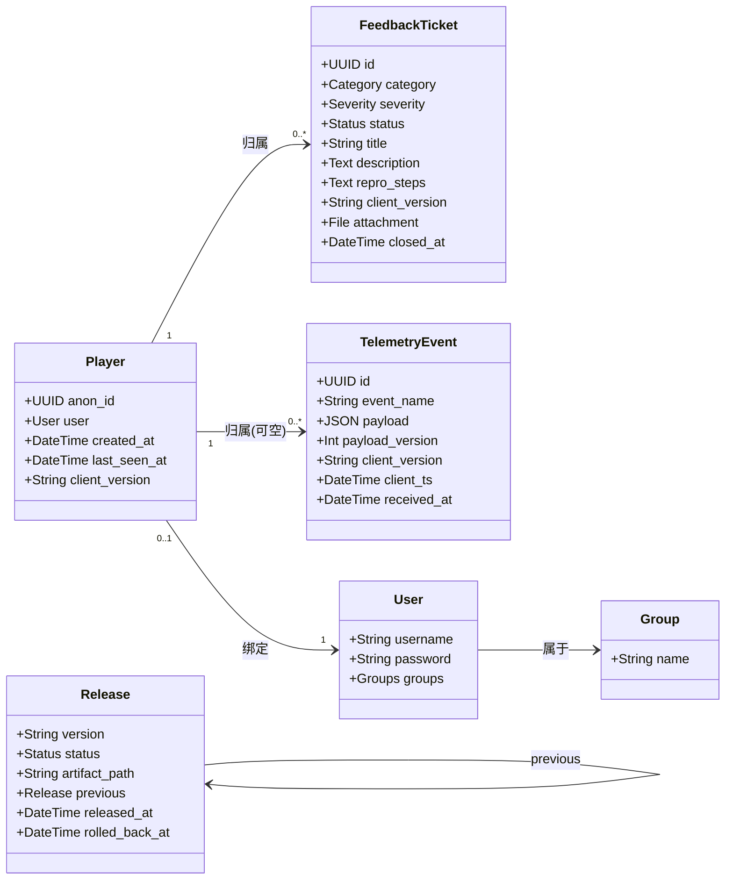

**关系要点：**

- `Player.anon_id` 是**匿名身份的根**。S1—S3 阶段 `user` 为空，S4 绑定账号后填上，历史反馈/遥测通过外键自动继承。
- `FeedbackTicket.player` / `TelemetryEvent.player` 用外键指向 `Player`（**不**直接存 `anon_id` 字符串），
  绑定账号时无需迁移历史数据。
- `TelemetryEvent.player` 可空：极少数校验失败但仍有价值的遥测（如客户端版本探测）可无归属入库。

### 2.5 模块划分与功能点一览

按《人员分工方案》§三，D5 的三项**设计输出**（反馈工单流程、匿名身份到账号的升级路径、后台信息架构与三角色权限边界）恰好对应三个详细设计模块：

| 模块 | 对应设计输出 | 覆盖阶段 | 功能点 |
|---|---|---|---|
| **A 匿名反馈工单系统** | 反馈工单流程（提交→分类→处理→验证→关闭） | S1/S2/S3 | A1 反馈提交 · A2 工单状态流转 · A3 遥测事件接收 |
| **B 匿名身份与账号体系** | 匿名身份到账号的升级路径 | S1/S4 | B1 匿名档案创建 · B2 账号注册/登录 · B3 匿名档案绑定账号 |
| **C 管理后台、RBAC 与发布运维** | 后台信息架构 + 三角色权限边界 | S2/S5/S6 | C1 三角色 RBAC 与审计日志 · C2 版本发布与回退 |

---

## 3. 模块 A：匿名反馈工单系统

### 3.0 模块职责与边界

- **职责**：把玩家的"问题 + 复现步骤 + 附件"收进来、归属到匿名档案、在后台看板上按状态机流转到关闭；同时接收游戏遥测事件用于诊断。
- **边界**：不碰游戏平衡数值（红线 2）；不上传玩家未主动提交的日志（UC07 / R09 隐私合规）；工单只由项目组成员在后台操作，玩家侧只读不到工单状态。
- **对应用例**：UC07 导出问题反馈、UC09 查看诊断与反馈。

### 3.1 功能点 A1：反馈提交

**功能说明**：玩家在游戏内点"反馈"按钮 → 填写问题分类 / 标题 / 描述 / 复现步骤（可附截图或日志附件）
→ 确认后提交。服务端校验并把工单归属到匿名档案。这是整个运维闭环的**入口**。

**关键约束**：

1. 提交**必须**带上 `anon_id`（客户端首次启动生成的 UUID）与 `client_version`，否则 400 拒绝。
2. 附件可选、限制类型与大小（见 §3.4 数据表）；附件落在本地数据卷，由 Caddy 静态服务，**不进数据库**。
3. 离线时写入本地待发队列，联网后补传（《技术选型》§8 第 8 条），反馈不丢失。

**活动图**：

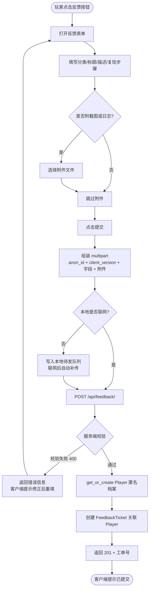

**时序图**：

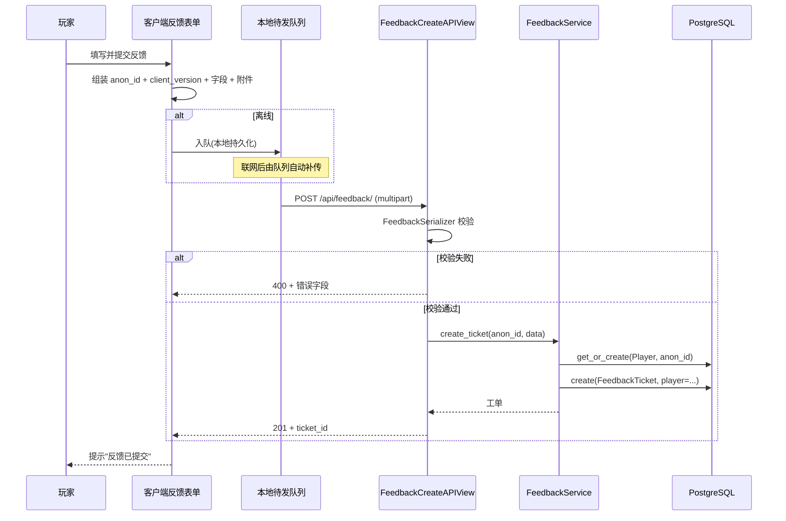

**类图**：

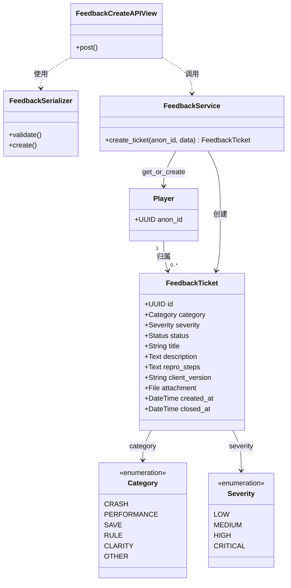

### 3.2 功能点 A2：工单状态流转

**功能说明**：项目组在 Django Admin 看板里把工单从"待分类"流转到"已关闭"。状态机是
**单向、可回溯**的（验证不通过退回"处理中"），每次流转自动写入 Django `LogEntry` 审计日志。

**状态机**（《人员分工方案》§三：提交 → 分类 → 处理 → 验证 → 关闭）：

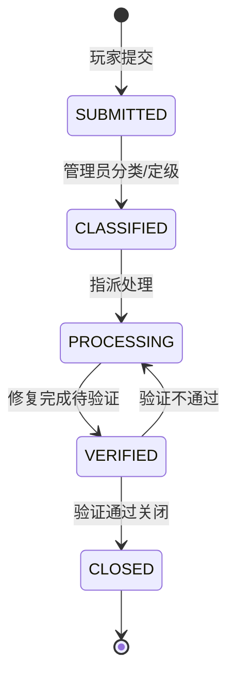

**活动图**：

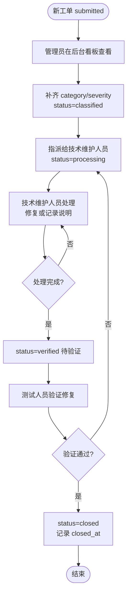

**时序图**：

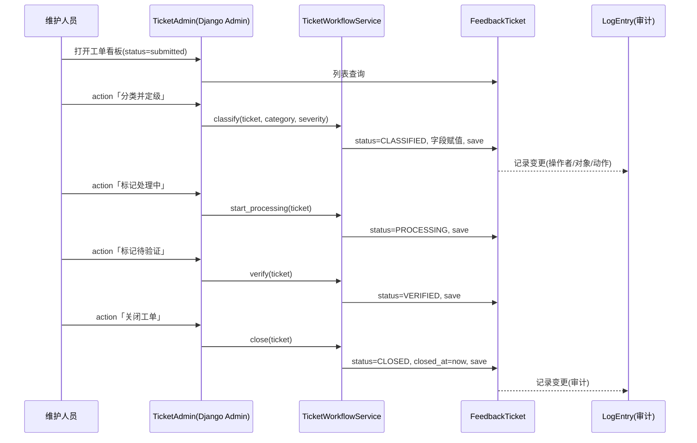

**类图**：

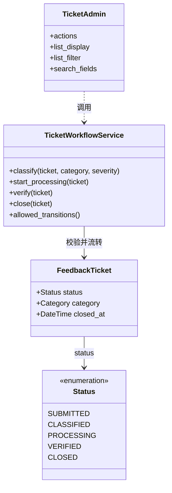

> **说明**：状态流转逻辑集中在 `TicketWorkflowService` 一个类里，**不散落在 Admin action 里**，
> 这样"验证不通过退回处理中"这类规则只在 `allowed_transitions()` 定义一次，既可在后台复用，
> 也可在 pytest 里直接单测（不依赖 Admin 运行环境）。

### 3.3 功能点 A3：遥测事件接收

**功能说明**：服务端接收客户端上报的**低频关键事件**（`run_started` / `room_cleared` / `run_ended`
/ `app_error`），用于技术维护人员按版本 / 事件类型定位问题（UC09）。这是"诊断日志"的服务端形态。

**三条硬约束（红线 1 + 隐私 R09 + 技术选型 §8 第 8 条）：**

1. **只上报低频里程碑事件**，高频战斗事件（`entity_damaged` / `entity_killed` 等）不上网络、只留本地诊断。
2. **fire-and-forget**：客户端用 `navigator.sendBeacon` / `fetch(keepalive)` 发送，**绝不 `await`**，服务端挂掉不影响游戏。
3. **离线不丢**：事件先入本地队列，联网后批量补传，服务端返回 202 才清队列。

**需要 D1 配合的 C1 扩展**：当前 C1 事件总线（`client/src/core/events.ts`）只有高频战斗事件，
缺少**局级生命周期事件**。D5 需要 D1 增补四个事件（字段见 §6）：

```
run_started / room_cleared / run_ended / app_error
```

这是 D5 遥测能工作的前提，已作为 C1 变更请求在周会提出。

**活动图**：

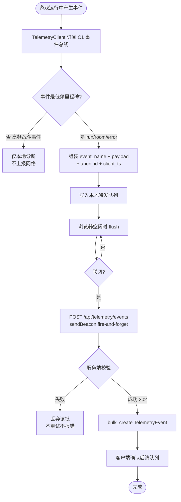

**时序图**：

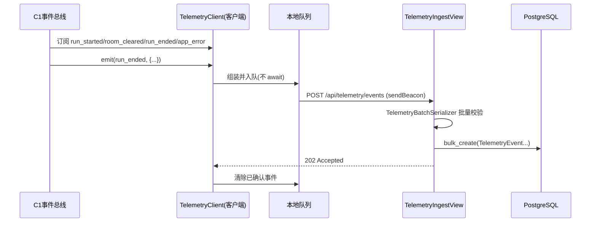

**类图**：

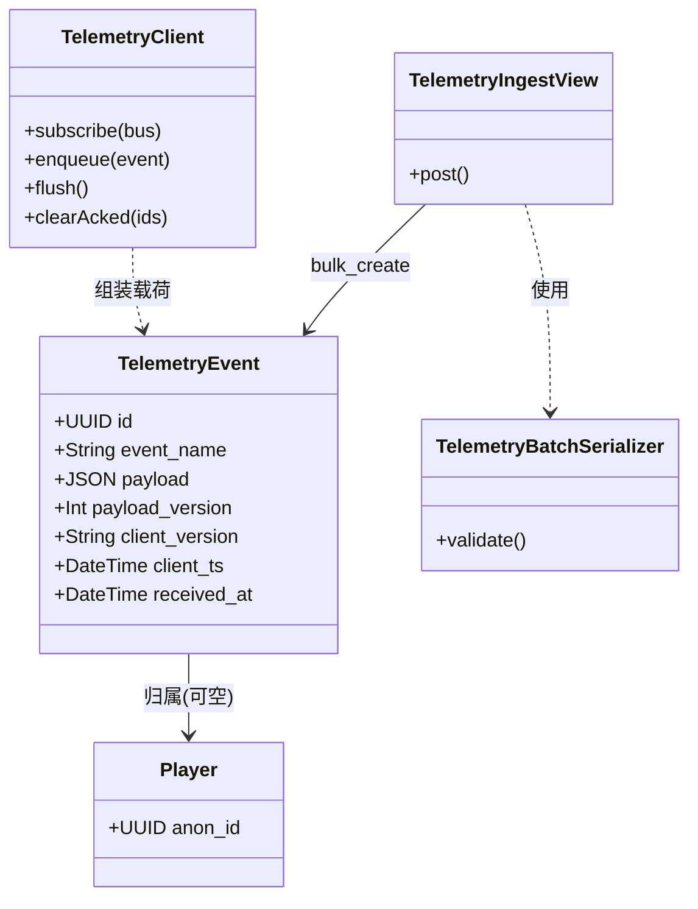

### 3.4 模块 A 数据表

**FeedbackTicket（反馈工单）**

| 字段 | 类型 | 约束 | 说明 |
|---|---|---|---|
| id | UUID | PK | |
| player | FK(Player) | 非空 | 匿名归属 |
| category | enum | 非空 | CRASH/PERFORMANCE/SAVE/RULE/CLARITY/OTHER |
| severity | enum | 非空，默认 LOW | LOW/MEDIUM/HIGH/CRITICAL |
| status | enum | 非空，默认 SUBMITTED | 见 3.2 状态机 |
| title | CharField(200) | 非空 | |
| description | TextField | 非空 | 问题描述 |
| repro_steps | TextField | 可空 | 复现步骤（UC07 要求） |
| client_version | CharField(32) | 非空 | 客户端版本号 |
| client_platform | CharField(64) | 可空 | 浏览器 UA 摘要 |
| attachment | FileField | 可空 | 截图/日志，类型与大小在 serializer 限制 |
| created_at / updated_at / closed_at | DateTime | auto | closed_at 关闭时写 |

**TelemetryEvent（遥测事件）**

| 字段 | 类型 | 约束 | 说明 |
|---|---|---|---|
| id | UUID | PK | |
| player | FK(Player) | 可空 | 匿名归属 |
| event_name | CharField(64) | 非空，索引 | run_started/room_cleared/run_ended/app_error |
| payload | JSONField | 非空 | 事件载荷（见 §6） |
| payload_version | IntField | 非空，默认 1 | 载荷结构版本，对应红线 3 |
| client_version | CharField(32) | 非空 | |
| client_ts | DateTime | 非空 | 客户端事件时间（非服务端接收时间） |
| received_at | DateTime | auto_now_add | 服务端入库时间 |

**索引策略**：`TelemetryEvent` 上建 `(event_name, client_version, received_at)` 联合索引——
后台看板按"版本 + 事件类型"过滤是最高频查询；`FeedbackTicket` 的 `status`、`created_at`
各建单列索引（`db_index=True`），分别支撑"按状态看板"与"按时间倒序"两类查询。

---

## 4. 模块 B：匿名身份与账号体系

### 4.0 模块职责与边界

- **职责**：建立"匿名档案"作为一切数据归属的根；S4 起提供账号注册/登录（JWT），并把匿名档案
  绑定到账号、历史数据自动继承。
- **边界**：账号只用于"身份标识 + 反馈归属 + 统计"，**进度仍存本地**（《人员分工方案》§十待确认项 2），
  本期不做云存档。
- **对应用例**：UC07 的匿名归属、S4 账号体系（需求 §2.1 三类维护角色的玩家侧对应物）。

### 4.1 功能点 B1：匿名档案创建

**功能说明**：客户端首次启动生成 UUID v4 作为 `anon_id`，存本地 `localStorage`（独立 key
`bjtu-rogue:anon_id`，与 D4 的 `bjtu-rogue:profile` 分开）。此后所有反馈/遥测请求携带它。
服务端 `get_or_create` 建立匿名档案，实现"最小 MVP 无账号"。

**活动图**：

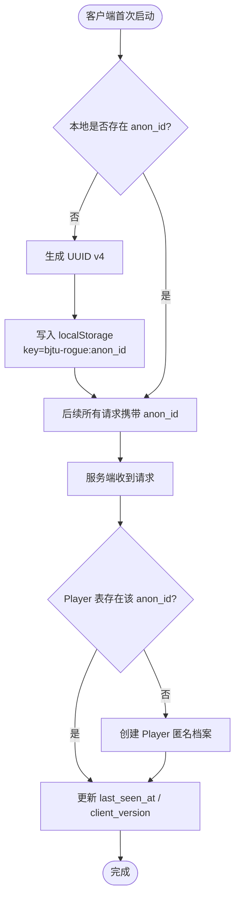

**时序图**：

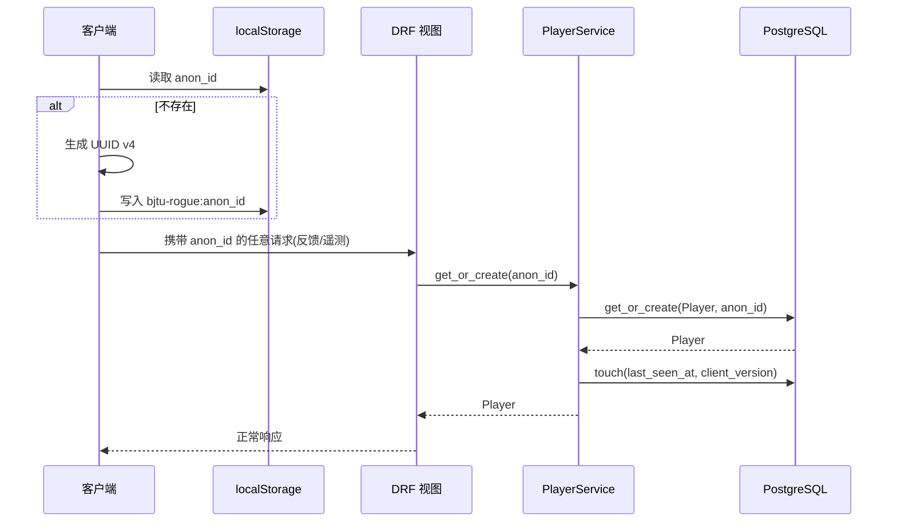

**类图**：

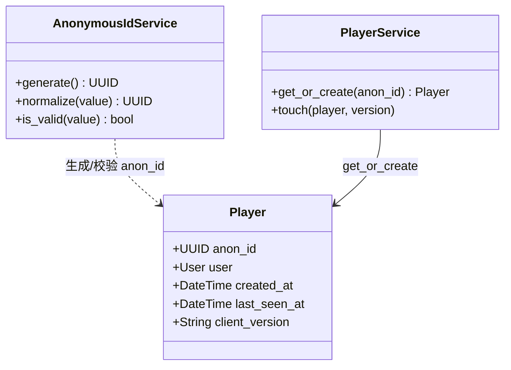

### 4.2 功能点 B2：账号注册 / 登录（JWT）

**功能说明**：S4 起玩家可（可选地）注册账号、用 JWT 登录。登录完全不影响单机玩法——不登录照样能玩、
能反馈。账号存在的意义是"给匿名档案一个可认领的名字"。

**技术要点**：`simplejwt` 负责签发 / 刷新令牌；密码用 Django 内置 `make_password` 哈希；
注册后**不自动绑定**匿名档案（绑定是下一步 B3 的显式动作）。

**活动图**：

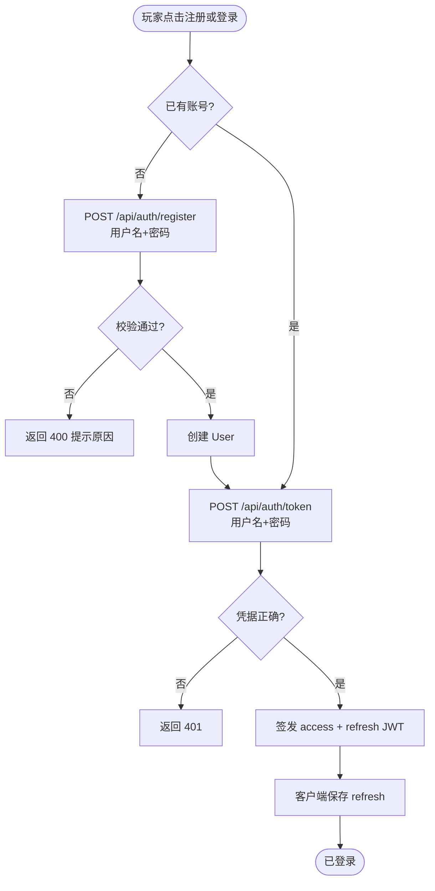

**时序图**：

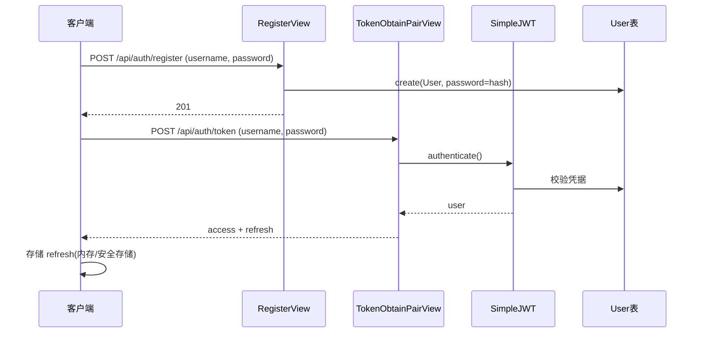

**类图**：

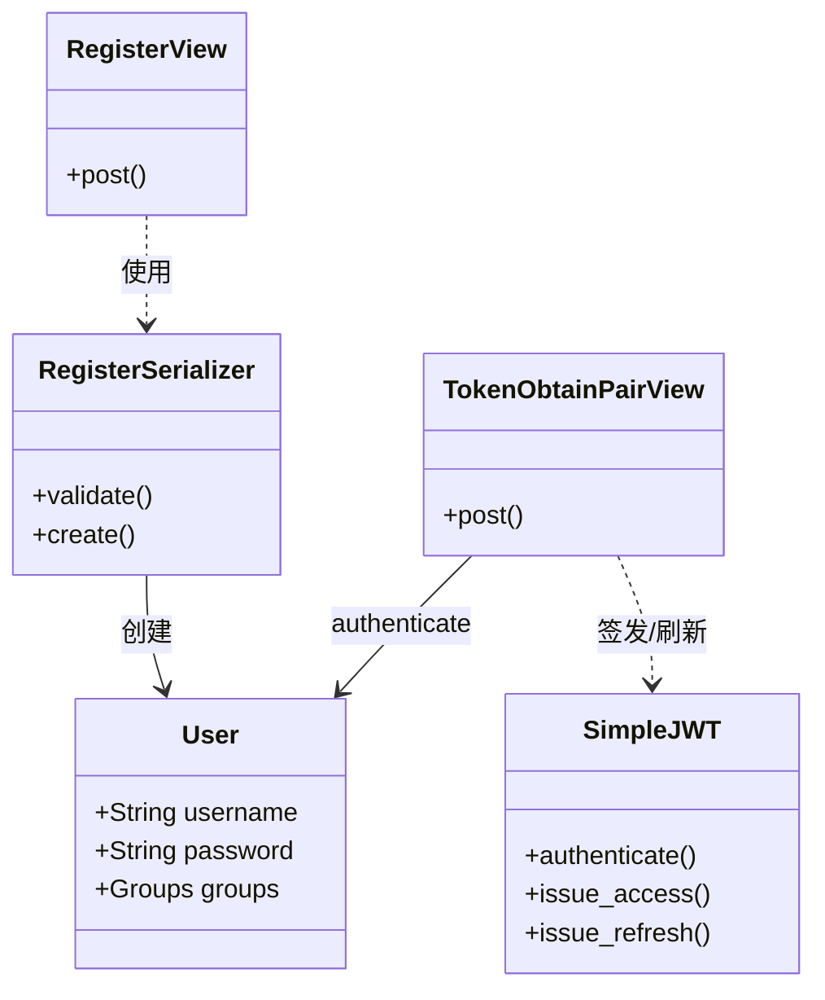

### 4.3 功能点 B3：匿名档案绑定账号（claim）

**功能说明**：S4 的关键一步。已登录玩家调 `POST /api/auth/claim`，把本地 `anon_id` 对应的匿名档案
绑定到当前账号。绑定后该档案名下的**历史反馈 / 遥测自动归入账号**，玩家看到"登录后历史还在"，而非数据清零。

**冲突处理**：若该 `anon_id` 已被**另一个**账号绑定，返回 409，防止一个匿名档案被抢认。
一个账号可认领多个匿名档案（玩家可能换过浏览器 / 清过缓存，每次产生新 `anon_id`）。

**活动图**：

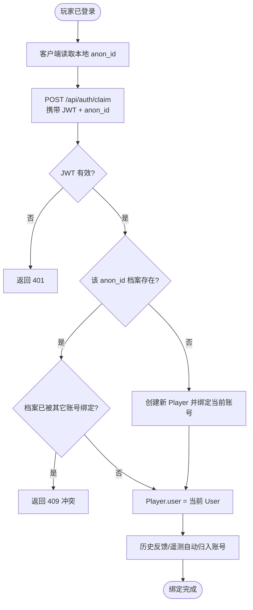

**时序图**：

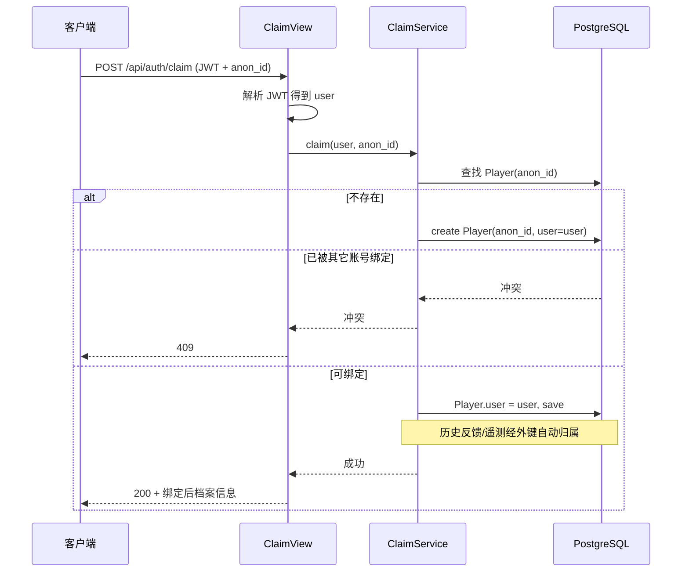

**类图**：

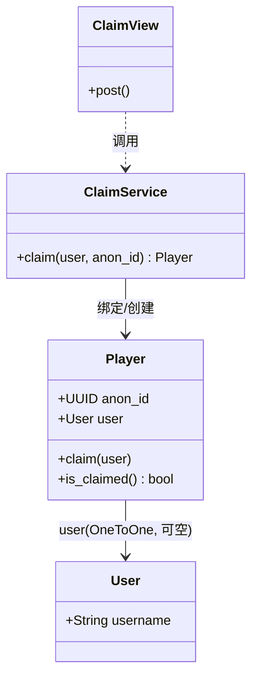

### 4.4 模块 B 数据表

**Player（匿名档案 / 玩家）**

| 字段 | 类型 | 约束 | 说明 |
|---|---|---|---|
| anon_id | UUIDField | unique, db_index | 客户端生成，匿名身份根 |
| user | OneToOneField(User) | null=True, blank=True, SET_NULL | S4 绑定后填；账号删除时档案保留为匿名 |
| created_at | DateTime | auto_now_add | 首次建档时间 |
| last_seen_at | DateTime | 可空 | 每次请求 touch |
| client_version | CharField(32) | 可空 | 最后一次上报的版本 |

> `user` 用 `SET_NULL` 而非 `CASCADE`：删除账号不清匿名档案及其反馈/遥测，
> 与"档案是数据归属的根、账号只是可选标签"的定位一致。

**User**：Django 内置 `auth.User`，不做自定义 User 模型——MVP 阶段账号字段就是用户名 + 密码，
自定义 User 会抬高迁移复杂度，收益为零（《技术选型》§6"近零开发量"）。

---

## 5. 模块 C：管理后台、RBAC 与发布运维

### 5.0 模块职责与边界

- **职责**：把 Django Admin 定制成"反馈看板 + 账号管理 + 配置管理 + 发布记录"四合一后台；
  按需求 §2.1 划分三类维护角色并做权限边界；落地版本发布与回退机制。
- **边界**：维护入口仅供项目组使用，普通玩家不能在游戏界面改任何配置（需求 §2.5）。
- **对应用例**：UC08 配置与校验内容、UC09 查看诊断与反馈、UC10 验证候选版本、UC11 发布更新与回退。

### 5.1 功能点 C1：三类角色 RBAC 与审计日志

**功能说明**：用 Django 的 `Group + Permission` 建三个维护角色，权限边界严格对应需求 §2.1：

| 角色 | 能做 | 不能做 |
|---|---|---|
| **内容配置人员** | 提交 / 编辑候选版本（`release.add_release`、`release.change_release`） | 不能直接发布、不能回退 |
| **技术维护人员** | 查看工单附件、查看遥测、发布与回退（`feedback.view_attachment`、`telemetry.view_event`、`release.publish`、`release.rollback`） | 不能流转工单状态、不能提交 / 编辑候选 |
| **测试人员** | 流转工单状态（标记验证）、编辑候选版本状态（`feedback.change_status`、`release.change_release`） | 不能发布 / 回退、不能查看附件 |

**审计日志**：全部通过 Django Admin 操作，自动走 `LogEntry`（记录操作者 / 动作 / 对象），
零额外开发。S5 只做"建 3 个 Group + 绑定自定义 Permission"。

**活动图**：

```mermaid
flowchart TD
    A([管理员登录 Django Admin]) --> B[创建/分配三类 Group<br>并绑定 Permission]
    B --> C[内容配置人员:<br>提交/编辑候选版本]
    C --> D[技术维护人员:<br>看附件/看遥测/发布/回退]
    D --> E[测试人员:<br>流转工单/编辑候选状态]
    E --> F[用户执行某操作]
    F --> G{权限校验 has_perm?}
    G -->|否| H[拒绝操作 403<br>或后台入口不可见]
    G -->|是| I[执行并写入 LogEntry]
    I --> J([操作可审计追溯])
```

**时序图**：

```mermaid
sequenceDiagram
    participant M as 维护人员
    participant A as Django Admin
    participant P as Permission检查
    participant L as LogEntry
    M->>A: 登录并操作(提交候选/回退/标记验证)
    A->>P: has_perm(对应 codename)
    alt 无权限
        P-->>A: 拒绝
        A-->>M: 403 / 入口不可见
    else 有权限
        P-->>A: 允许
        A->>L: 记录(user, action_flag, object)
        A-->>M: 执行成功
    end
```

**类图**：

```mermaid
classDiagram
    class Group {
        +String name
    }
    class Permission {
        +String codename
        +String name
    }
    class User {
        +Groups groups
    }
    class LogEntry {
        +User user
        +Int action_flag
        +ContentType content_type
        +String object_repr
        +DateTime action_time
    }
    class FeedbackTicket
    class Release
    class Player
    User --> Group : 属于
    Group --> Permission : 拥有
    LogEntry --> User : 记录操作者
    LogEntry ..> FeedbackTicket : 审计对象
    LogEntry ..> Release : 审计对象
    LogEntry ..> Player : 审计对象
```

> **三角色对应的自定义 Permission**（定义在 `FeedbackTicket` / `Release` / `TelemetryEvent`
> 的 `Meta.permissions`，由 `manage.py setup_roles` 管理命令分配到三个 Group）：
>
> - 内容配置人员：`release.add_release`、`release.change_release`
> - 技术维护人员：`feedback.view_attachment`、`telemetry.view_event`、`release.publish`、`release.rollback`
> - 测试人员：`feedback.change_status`、`release.change_release`

### 5.2 功能点 C2：版本发布与回退

**功能说明**：落地 UC11。客户端构建产物按版本号分目录（`/game/vX.Y.Z/`），发布 = 把 `current`
软链接指向验证通过的新版本目录；回退 = 把 `current` 指回上一稳定版。**回退瞬间完成且不影响数据库**
（《技术选型》§7）。数据库侧只需一张 `Release` 表记录发布轨迹，供审计与看板展示。

**关键约束**：

1. 只发布**测试人员验证通过**的版本（UC11"仅发布验证通过的版本"）。
2. 发布前备份当前版本目录，回退不覆盖任何存档（R08）。
3. 回退不改数据库 schema——前端静态产物回退，服务端 API 保持向后兼容。

**活动图**：

```mermaid
flowchart TD
    A([CI 构建通过]) --> B[产物上传 /game/vX.Y.Z/]
    B --> C[创建 Release 记录 status=candidate]
    C --> D{测试人员验证通过?}
    D -->|否| E[记录验证失败<br>不发布]
    D -->|是| F[切换 current 软链接指向新版]
    F --> G[Release.status=released<br>previous=旧版]
    G --> H[玩家刷新即获得新版]
    H --> I{线上发现严重问题?}
    I -->|否| J([发布完成])
    I -->|是| K[检查存档/API 兼容性]
    K --> L[切换 current 指回上一稳定版]
    L --> M[Release.status=rolled_back]
    M --> J
```

**时序图**：

```mermaid
sequenceDiagram
    participant CI as GitHub Actions
    participant R as ReleaseService
    participant FS as 静态目录/Caddy
    participant DB as Release表
    CI->>R: 上传构建产物 /game/v1.2.3/
    R->>DB: create Release(version, status=CANDIDATE)
    Note over R: 测试人员在后台标记 VERIFIED
    R->>FS: 切换 current → /game/v1.2.3/
    R->>DB: status=RELEASED, previous=旧版, released_at
    alt 需要回退
        R->>DB: 读取 previous
        R->>FS: 切换 current → 上一稳定版
        R->>DB: status=ROLLED_BACK, rolled_back_at
    end
```

**类图**：

```mermaid
classDiagram
    class Release {
        +String version
        +Channel channel
        +Status status
        +String artifact_path
        +Text release_notes
        +Release previous
        +DateTime released_at
        +DateTime rolled_back_at
    }
    class Status {
        <<enumeration>>
        CANDIDATE
        VERIFIED
        RELEASED
        ROLLED_BACK
    }
    class ReleaseService {
        +release(version)
        +rollback()
        +mark_verified(version)
        +check_compatibility()
    }
    class CaddyFileSystem {
        +switch_current(target)
        +backup_current()
    }
    Release --> Release : previous
    Release --> Status : status
    ReleaseService --> Release : 读写
    ReleaseService ..> CaddyFileSystem : 切换 current
```

### 5.3 模块 C 数据表

**Release（发布记录）**

| 字段 | 类型 | 约束 | 说明 |
|---|---|---|---|
| version | CharField(32) | unique | 语义化版本 vX.Y.Z |
| channel | CharField(16) | 默认 stable | 本期只有 stable |
| status | enum | 非空 | CANDIDATE/VERIFIED/RELEASED/ROLLED_BACK |
| artifact_path | CharField(256) | 非空 | /game/vX.Y.Z/ |
| release_notes | TextField | 可空 | 更新说明（UC11"附更新说明"） |
| previous | FK(self) | 可空 | 上一版本，回退目标 |
| released_at / rolled_back_at | DateTime | 可空 | |

> `Release` 是**发布轨迹的记录**，不是发布动作的执行者——真正的"切换 current"是文件系统/Caddy
> 操作（发布流水线执行），`ReleaseService` 只更新状态、记录轨迹。数据库只保证"每次发布/回退都有迹可查"。

---

## 6. C3 服务端 API 契约

D5 是 C3（服务端 API 契约）的 owner。契约由 `drf-spectacular` 自动生成 OpenAPI，客户端据此开发，
可用 Mock 先行。下面是各端点的**语义级**定义，字段以 OpenAPI 为准。

### 6.1 端点总览

| 方法 | 路径 | 阶段 | 鉴权 | 说明 |
|---|---|---|---|---|
| GET | `/api/health/` | S0 | 无 | 健康检查，返回 200 + 状态与服务名 |
| POST | `/api/feedback/` | S1 | 匿名（anon_id） | 提交反馈（multipart，含附件） |
| POST | `/api/telemetry/events/` | S3 | 匿名（anon_id） | 批量接收遥测事件，fire-and-forget |
| POST | `/api/auth/register/` | S4 | 无 | 注册账号 |
| POST | `/api/auth/token/` | S4 | 无 | simplejwt 获取 access/refresh |
| POST | `/api/auth/refresh/` | S4 | 无 | 刷新 access |
| POST | `/api/auth/claim/` | S4 | JWT | 匿名档案绑定账号 |
| GET | `/api/profile/save/` | 云存档 | JWT | 拉取云存档（无档 404） |
| PUT | `/api/profile/save/` | 云存档 | JWT | 上传云存档（`base_revision` 乐观并发，落后 409） |
| DELETE | `/api/profile/save/` | 云存档 | JWT | 清除云存档 |

后台（工单看板 / 账号管理 / RBAC / 发布）走 **Django Admin**，不走 REST，不在 OpenAPI 里。

### 6.2 关键请求 / 响应示例

**POST /api/feedback/**（S1）：

```json
// multipart/form-data 文本字段
{
  "anon_id": "7c9e6679-7425-40de-944b-e07fc1f90ae7",
  "category": "crash",
  "severity": "high",
  "title": "第三关 Boss 死亡后黑屏",
  "description": "击败终焉蛛王后画面变黑，无法进入结算",
  "repro_steps": "进入第三关 -> 击败 Boss -> 黑屏",
  "client_version": "0.3.1"
}
// 附件字段 attachment: 可选文件（multipart）
// 响应 201（返回工单完整序列化，字段见 FeedbackSerializer）
{
  "id": "f47ac10b-58cc-4372-a567-0e02b2c3d479",
  "category": "crash",
  "severity": "high",
  "title": "第三关 Boss 死亡后黑屏",
  "description": "击败终焉蛛王后画面变黑，无法进入结算",
  "repro_steps": "进入第三关 -> 击败 Boss -> 黑屏",
  "client_version": "0.3.1",
  "client_platform": "",
  "attachment": null,
  "status": "submitted",
  "created_at": "2026-10-15T12:00:00Z"
}
```

**POST /api/telemetry/events/**（S3）：

```json
{
  "anon_id": "7c9e6679-7425-40de-944b-e07fc1f90ae7",
  "client_version": "0.3.1",
  "events": [
    { "name": "run_started", "client_ts": "2026-10-15T12:00:00Z",
      "payload": { "seed": 123456, "characterId": "student", "difficulty": "normal" } },
    { "name": "run_ended", "client_ts": "2026-10-15T12:08:30Z",
      "payload": { "result": "dead", "depth": 2, "kills": 41 } }
  ]
}
// 响应 202（Accepted，无 body）
```

**POST /api/auth/claim/**（S4）：

```json
// 请求头 Authorization: Bearer <access>
{ "anon_id": "7c9e6679-7425-40de-944b-e07fc1f90ae7" }
// 响应 200
{ "claimed": true, "anon_id": "7c9e6679-7425-40de-944b-e07fc1f90ae7", "feedback_count": 3, "telemetry_count": 128 }
```

### 6.3 遥测事件载荷（需 D1 在 C1 增补的局级事件）

| event_name | 触发时机 | payload 关键字段 | 用途 |
|---|---|---|---|
| run_started | 进入地牢 | seed, characterId, difficulty | 定位"某种子/难度下的问题" |
| room_cleared | 清房 | roomId, seed, clearTime, depth | 关卡节奏与难度曲线分析 |
| run_ended | 通关/死亡 | result(win/dead), depth, kills, unlocks | 结算统计 + 到达进度 |
| app_error | 未捕获异常 | message, stack(截断), scene | 崩溃排查（不含个人信息） |

> 高频事件（`entity_damaged` / `entity_killed` / `enemy_split`）**明确排除**在网络遥测外，
> 只在客户端本地用于诊断，符合红线 1 与 R09 隐私要求。

---

## 7. 关键设计决策与风险

### 7.1 关键设计决策

| # | 决策 | 理由 | 代价 / 取舍 |
|---|---|---|---|
| D-1 | 数据归属统一挂在 `Player` 匿名档案上，反馈/遥测用外键而非存 `anon_id` 字符串 | S4 绑定账号时历史数据经外键**自动**继承，无需迁移 | 每次写入多一次外键 join（量级很小） |
| D-2 | 服务端不存储任何游戏平衡数值 | 红线 2；平衡数据留在客户端配置表，服务端不重复、不漂移 | 后台无法直接改数值，需走 D2 配置管线 |
| D-3 | 遥测只收低频里程碑事件，高频战斗事件不上报 | 红线 1 + R09 隐私 + 流量控制 | 诊断信息不如"全量事件"丰富，靠反馈包补充 |
| D-4 | 工单状态流转集中在 `TicketWorkflowService`，不散在 Admin action | 规则单一来源、可 pytest 单测 | 多一个类，但消除了"流转规则写死在前端"的风险 |
| D-5 | 账号不自定义 User、不做云存档 | 《技术选型》§6"近零开发量"；进度仍存本地 | 将来若做云存档需回头改 |
| D-6 | 发布/回退靠"版本目录 + current 软链接"，数据库只记轨迹 | UC11 要求"回退瞬间完成且不影响数据库" | 需在 S0 就把目录方案定死 |

### 7.2 风险与缓解（承接需求文档 R08 / R09）

| 风险 | 缓解 |
|---|---|
| R08 存档 / 版本回退兼容 | 回退只切前端静态目录，不动数据库；回退前 `check_compatibility()`；`Release.previous` 记录回退目标 |
| R09 日志隐私合规 | 遥测只收必要游戏事件；反馈需玩家主动提交；附件不自动上传；管理员读附件走"只读下载"而非内容展示 |
| 客户端遥测模块的目录归属（D5 跨进 `client/`） | 提议新建 `client/src/net/` 归 D5 维护，作为"粘合 D1—D4 代码"的落点，需周会确认 |

### 7.3 待确认事项（回指《人员分工方案》§十）

1. 玩家账号深度：本设计按"身份标识 + 反馈归属 + 统计，进度存本地"实现，**不做云存档**。
   若决定做云存档，模块 B 需增补同步 API 并重估工作量。
   > **已决议（2026-10-23）**：云存档已落地为模块 D `apps/cloudsave/`，契约见
   > `docs/云存档接口草案.md`（§四，已冻结）与本设计 §6.1 新增三行。本地档仍是唯一运行时真值，
   > 云存档只做可选备份/跨设备同步，不改变「进度存本地」的红线。
2. 客户端遥测/反馈适配层放 `client/src/net/`（D5 所有）还是并入 `client/src/domains/meta/`（D4 所有），
   待周会定，不影响服务端本文其余设计。

---

> **文档落点**：本文位于 `docs/服务端与运维详细设计.md`，服务端代码已按本文实现到 `server/` 目录。
> 图用 Mermaid 绘制，在 VS Code / GitHub / Typora 中可直接渲染。
